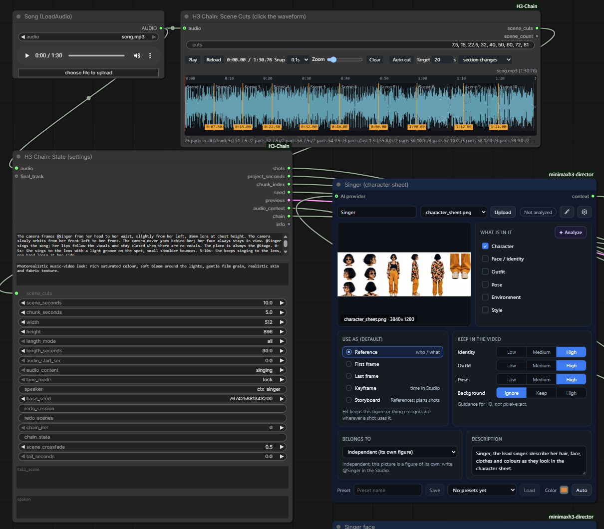
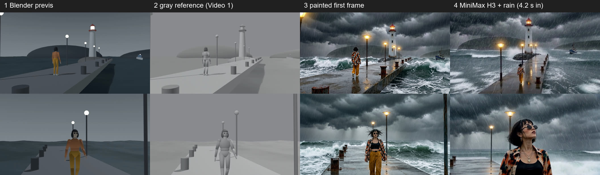
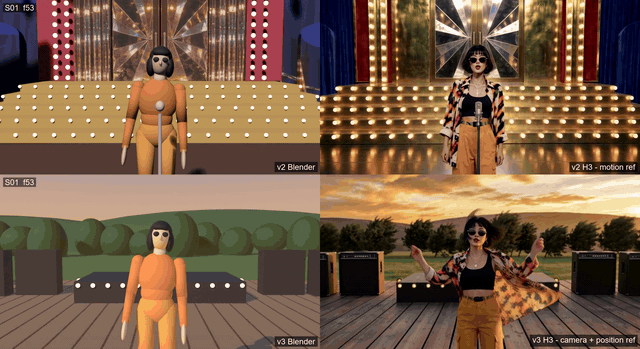
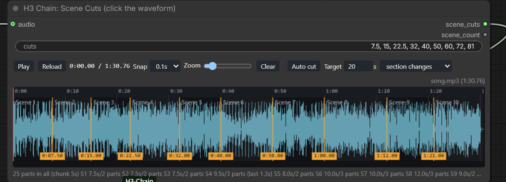

# H3 Chain: one-click music videos and Blender cutscenes with MiniMax H3

[日本語](README_ja.md)

Two workflows for MiniMax H3 in ComfyUI, both made for a 12 GB GPU:

| | Input | Output |
|---|---|---|
| **H3 Chain** (this page) | a song + image cards of a character | a lip-synced music video of any length, one click |
| **[Cutscenes](cutscene/README.md)** | a scene planned in Blender + a character sheet | shots that follow the Blender camera and motion |


## H3 Chain

H3 Chain is a ComfyUI node pack for MiniMax H3. You put in a whole song (or a dialogue track) and the image cards of
your character, press **Run once**, and it renders the video part by part to the end of the song, then joins it
into one `final.mp4` with the original audio. It runs on a 12 GB GPU (tested on an RTX 4070 Ti), whatever the length
of the song.

- **One job per render part** (5 s by default). The Step node saves the part and queues the next job itself, so memory
  is freed between parts.
- **One Director plan per scene.** A scene change is a clean cut at the start of a part; inside a scene the parts
  continue exactly like the H3 Director (22 pinned frames and the last second of sound).
- **The audio is locked.** Every scene gets its slice of the song as the Director's audio card, so the lips follow the
  vocals; `final.mp4` carries the original track, so it stays in sync over the whole song.
- Scene dissolves, a silent ending, redoing single scenes, rendering one part of a song.
- **Dials** ([ComfyUI-Dials](https://github.com/matlowai/ComfyUI-Dials)) can be put into the graph for more motion or
  a different expression.
- Command-line tools: build a workflow from a small `song.json`, refine small faces, join parts and intros.
- A [Claude Code](https://claude.com/claude-code) skill (`/new-song`) that turns a folder of materials into an MV.



## Cutscenes

Block out a scene in Blender (one `cutscene.json`: set, mannequin, cameras), check the previs, paint the first frame of
each shot, and let H3 render the shots along the Blender camera. Walkthrough, requirements and examples:
**[cutscene/README.md](cutscene/README.md)**.



**Singing cutscenes:** the same song in two versions, one that follows the mannequin's motion, and one that takes only the
camera and the position from Blender and dances freely. Both are lip-synced:
[how they differ and how to make them](cutscene/README.md#singing-lip-sync).



For cutscenes only, you don't need to install the node pack or the Director.

## Contents

| Path | What it is |
|---|---|
| `nodes.py`, `__init__.py`, `web/` | The nodes: **H3 Chain: State**, **Step**, **Scene Cuts** (waveform editor), **Audio Lock** (for face refine) |
| `example_workflows/H3_Chain_Song.json` | Singing MV: character sheet + face + background cards, song, Scene Cuts, State, Step |
| `example_workflows/H3_Chain_Song_Dials.json` | The same with Load Dial + Apply Dial (`h3_motion` at +0.5) |
| `example_workflows/H3_Cutscene_Shot.json` | One cutscene shot: first frame + character sheet + Blender reference video |
| `cutscene/` | The cutscene tools and two examples ([README](cutscene/README.md)) |
| `tools/` | `new_song.py`, `watch_chain.py`, `face_sizes.py`, `face_refine.py`, `apply_facerefine.py`, `join_parts.py`, `join_intro.py`, `example_song.json` |
| `tools/make_voices.py`, `tools/new_story.py` | Experimental: a dialogue story instead of a song (OmniVoice voices; see the docstrings) |
| `skills/new-song/`, `skills/new-cutscene-movie/` | Claude Code skills |
| `tests/test_logic.py` | Tests of the scene planning (run with ComfyUI's Python) |

## Requirements (H3 Chain)

Custom nodes:

| Pack | Needed for |
|---|---|
| [ComfyUI-MiniMaxH3-Director](https://github.com/seesee75-commits/ComfyUI-MiniMaxH3-Director) | Always (Director, image cards, connector, output). ComfyUI's own MiniMax H3 support must be present |
| [ComfyUI-Dials](https://github.com/matlowai/ComfyUI-Dials) | The Dials workflow and `"dial"` in song.json |
| [ComfyUI-H3-FaceRefine](https://github.com/Carasibana/ComfyUI-H3-FaceRefine) | `face_refine.py` |
| [ComfyUI-VideoHelperSuite](https://github.com/Kosinkadink/ComfyUI-VideoHelperSuite) | `face_refine.py` |

Models (the loaders in the workflows use these names; pick your own files in the loaders if yours differ):

| Folder | File | Source |
|---|---|---|
| `diffusion_models/h3/` | `minimax_h3_fl2va_pruned_int8_convrot.safetensors` | [Comfy-Org/MiniMax-H3](https://huggingface.co/Comfy-Org/MiniMax-H3) |
| `diffusion_models/minimax/` | `Minimax-h3_Singularity_ref2va_v2_Pruned_int8.safetensors` (ref2va, used for all tests) | Singularity fine-tune (WarmBloodAban/Minimax-h3_Singularity; a pruned int8 build is published separately). The official `minimax_h3_ref2va_pruned_int8_convrot.safetensors` from Comfy-Org also works in this slot |
| `loras/minimax/` | `pika_h3_flex_ref2va_v1_bf16.safetensors` (Pika LoRA, LCM 6 steps) | [Comfy-Org/MiniMax-H3](https://huggingface.co/Comfy-Org/MiniMax-H3) (`loras/`), from [Pika-Labs/Pika-H3-Flex](https://huggingface.co/Pika-Labs/Pika-H3-Flex) |
| `text_encoders/` | `qwen3vl_32b_minimax_h3_nvfp4_awq.safetensors` | Comfy-Org/MiniMax-H3 |
| `vae/` | `minimax_h3_video_vae_fp16.safetensors`, `minimax_h3_audio_vae_fp32.safetensors` | Comfy-Org/MiniMax-H3 |
| `loras/dials/` | `h3_motion.safetensors`, `h3_evil_*.safetensors` (optional) | [ComfyUI-Dials](https://github.com/matlowai/ComfyUI-Dials) |
| `ultralytics/` | `face_yolov8n.pt` (face refine only) | Impact Pack / Ultralytics face model |

Check the licences of the models (MiniMax H3 Community License, Pika H3 Flex) before commercial use.

## Install

1. Clone into `ComfyUI/custom_nodes/` and restart ComfyUI:

   ```
   git clone https://github.com/kei1975/comfyui-H3-PIKA-lipsync-blender-chain.git
   ```

2. Open `example_workflows/H3_Chain_Song.json` (drag it onto the canvas).

## Quick start (in ComfyUI)

1. Put your song into **LoadAudio**, and your character sheet, a face close-up and a background image into the three
   image cards. Describe each one in its text box.
2. Click the **Scene Cuts** waveform to place scene changes (or leave it empty: a new scene every `scene_seconds`).
   **Auto cut** places them on bar starts near section changes.

   

3. Write one text per scene in **State > scenes**, separated by blank lines. Call the cards with `@Name`. If there are
   more scenes than texts, the texts repeat.
4. Try `length_mode = seconds`, `length_seconds = 15` first, then `all`.
5. Press **Run** once. Output: `ComfyUI/output/H3Chains/<date>_vNN/` (`scene_001.mp4` ..., `final.mp4`, `plan.json`,
   `scenes.txt`). To stop, clear the ComfyUI queue.

To redo scenes: set `redo_session` (e.g. `20261117_v16`) and `redo_scenes` (e.g. `2,5`) on the State node and Run. It
remakes those scenes and writes `final_2.mp4`. Clear `redo_scenes` afterwards.

### State settings

| Setting | |
|---|---|
| `chunk_seconds` | One job. 5 s works on 12 GB up to 1056x576 |
| `width` / `height` | Same as the Director |
| `scene_cuts` / `scene_seconds` | Scene changes. Scenes shorter than 4.5 s are merged into the one before |
| `lane_mode` | `lock` (recommended): the audio is used as it is and the lips follow it |
| `speaker` | context_id of the singing / speaking card (optional) |
| `base_seed` | Scene k uses base_seed + 1000 x k |
| `length_mode`, `length_seconds`, `audio_start_sec` | Render only a part of the audio |
| `scene_crossfade` | Dissolve between scenes (0.5 s default, 0 = cut). Length and lip sync do not change |
| `final_track` (input) | Optional audio for `final.mp4` (H3 hears `audio`, e.g. a bass-boosted mix; final gets this) |
| `tail_seconds`, `tail_scene` | Silence after the song, optionally as its own ending scene (5 s or more) |

## Writing scene texts that survive the render parts

The Director splits each scene into 5 s parts and keeps only some of the text in part 2:

- A sentence that starts "The camera ..." is kept in every part, but if it contains a move word (orbit, dolly, push,
  pan, track, circle, glide, rise, sweep, arc, move, ...), part 2 gets "The camera holds a static shot" instead.
  So write **"The camera frames ..." with no move word**, then the move as its own sentence.
- Then `0–5s: <beat 1> 5–10s: <beat 2>`. **Beat 2 must not say "camera".**
- **Every beat should say the character sings.** A beat that only describes a pose ("points at the lens with a
  smile", "a wink") closes the mouth for that whole part.
- Keep the face large (head to waist or closer) and write "from the very first frame she is already standing close to
  the lens" when the background is a long street; otherwise she walks in from far away and the lips can't follow.
- Add "The camera never goes behind her; her face always stays in view." Orbits otherwise end on her back.

`tools/new_song.py` checks the first rule for you.

## Command-line tools

Set `COMFYUI_DIR` to your ComfyUI folder (and `COMFYUI_URL` if it is not `http://127.0.0.1:8188`). `ffmpeg` and
`ffprobe` must be on PATH. `new_song.py` and `face_refine.py` need a Python with comfy-cli (`pip install comfy-cli`);
`face_sizes.py` and `apply_facerefine.py` run with ComfyUI's own Python.

```
# 1. a song.json next to your materials (see tools/example_song.json and the new_song.py docstring)
python tools/new_song.py my_song/song.json --submit         # writes the workflow, checks the texts, queues it
python tools/watch_chain.py                                 # waits until the chain has finished
python tools/new_song.py my_song/song.json --redo 20261117_v16 "3,7" --submit   # redo scenes 3 and 7

# 2. faces that are too small
<ComfyUI python> tools/face_sizes.py <ComfyUI>/output/H3Chains/<session>
python tools/face_refine.py my_song/song.json <session> "4,9" --denoise 0.3 --submit
<ComfyUI python> tools/apply_facerefine.py <session> "4,9"            # -> final_N.mp4

# 3. one song in parts (song.json "audio_start" / "length"), and an intro in front
python tools/join_parts.py song.mp3 joined.mp4 partA/final.mp4 0 partB/final.mp4 10
python tools/join_intro.py intro/scene_001.mp4 joined.mp4 final_with_intro.mp4
```

song.json in short: `name`, `version`, `audio`, `character {name, image, description}`, `face` (optional),
`location {name, image, description}`, `look`, `idea`, `common`, `intro` + `intro_cut` (optional),
`shots [[framing + move, beat 1, beat 2], ...]`, `scene_seconds` (10), `width` / `height` (512 x 896),
`crossfade` (0.5), `seed`, `tail_seconds`, `tail_scene`, `audio_start`, `length`, `dial`, `turbo` (see the docstring).

## Dials

`example_workflows/H3_Chain_Song_Dials.json`, or `"dial": {"name": "h3_motion", "strength": 0.5}` in song.json, puts
**Load Dial -> Apply Dial** between the Pika LoRA and the Director's context connector. Load Dial only lists files in
`models/loras/dials/`.

What we saw (5 s clips, same seed, only the strength changed):

| Dial | Result |
|---|---|
| `h3_motion` +0.5 | Bigger camera push-in and hair / arm movement; face and clothes hold |
| `h3_motion` +1.0 | The camera rushes at the face, hands come in front of the lens |
| `h3_motion` +1.5 | The stage and background turn into something else; ends on the back |
| `h3_evil_sinister` / `creepy` / `dread` +1.5 | Darker room, wide-eyed staring face |
| `h3_evil_unhinged` +1.5 | Hair stands up, the face distorts (identity lost) |
| `h3_evil_corrupted` +1.5 | Dull, rough skin |
| `h3_evil_impish` +1.5 | Raised eyebrows, leaning in |
| `h3_evil_cold` / `seductive` +1.5 | Close to the base |

`h3_motion` pushes towards locomotion: the singer walks or runs around. For a singer who should stay in one place,
leave it off and ask for "a light groove on the spot" in the text instead; use it for running or chase scenes.

## Claude Code skills

Copy the folders in `skills/` into your project's `.claude/skills/` (or `~/.claude/skills/`).

**new-song**: give Claude Code a folder
with a song, a character sheet, a face close-up and a background, and say "new song" (or `/new-song <folder>`). It
writes the song.json, renders the whole song and reports back.

**new-cutscene-movie**: describe a scene and give a character sheet. It writes the previs, waits for your OK, then
renders the shots in H3.

## Notes

- Scene lengths are rounded to H3's frame grid (e.g. 9.5 s -> 9.42 s).
- A scene does not continue from the scene before (clean cut). If the place does not change, use longer scenes.
- 12 GB: 512 x 896 (or 896 x 512), 5 s parts. A 3-minute song takes about 2.5 to 3.5 hours.
- If an older private copy of H3 Chain is installed, remove it first: both register the same node names.

## Licence

MIT (see `LICENSE`). The models and the other custom nodes have their own licences.
