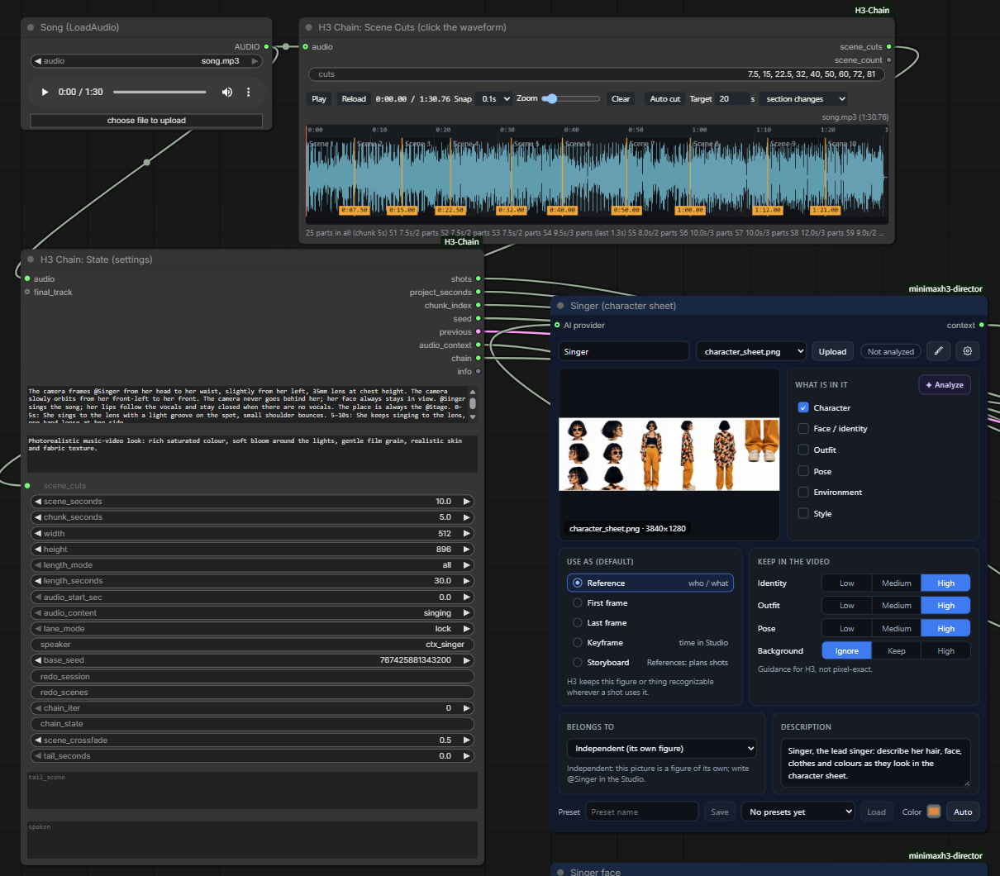
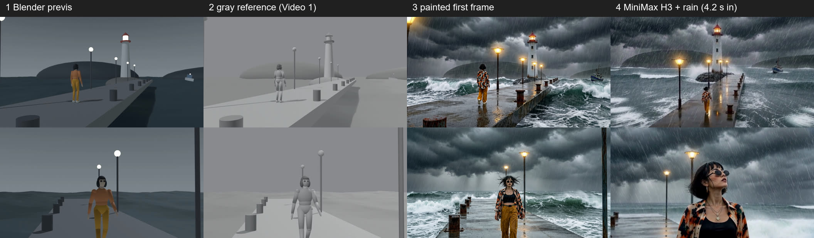
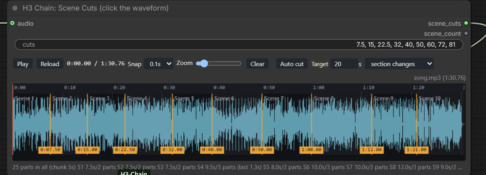

# H3 Chain: MiniMax H3 でワンクリック MV と Blender カットシーン

[English](README.md)

ComfyUI の MiniMax H3 用のワークフローが 2 つ入っています。どちらも 12GB の GPU 向けです。

| | 入力 | 出力 |
|---|---|---|
| **H3 Chain**（このページ） | 曲とキャラクターの画像カード | 口の合った MV（長さ自由、ワンクリック） |
| **[カットシーン](cutscene/README_ja.md)** | Blender で組んだシーンとキャラシート | Blender のカメラと動きに従うショット |


## H3 Chain

H3 Chain は MiniMax H3 用の ComfyUI ノードパックです。曲（またはセリフ音声）1 本とキャラクターの画像カードを入れて
**Run を 1 回**押すと、曲の最後までパートごとに自動で生成し、元の音声を付けた 1 本の `final.mp4` にまとめます。
曲の長さに関係なく 12GB の GPU で動きます（RTX 4070 Ti で確認）。

- **1 ジョブ = 1 パート**（既定 5 秒）。Step ノードがパートを保存して次のジョブを自分で投入するので、パートごとにメモリが解放されます。
- **シーンごとに Director の計画を分けます。** シーンの変わり目はパートの頭でクリーンに切り替わり、シーンの中は H3 Director と同じつなぎ方
  （前パートの最後 22 フレームと 1 秒の音を引き継ぐ）です。
- **音声は Lock。** 曲をシーンごとに切り出して Director の音声カードとして渡すので、口が歌に合います。`final.mp4` には元の音声を付けるので、長い曲でもずれません。
- シーンの境目のディゾルブ、曲の後の無音エンディング、シーン単位の作り直し、曲の一部だけの生成。
- **Dials**（[ComfyUI-Dials](https://github.com/matlowai/ComfyUI-Dials)）をグラフに入れて、動きや表情を変えられます。
- コマンドラインのツール: 小さな `song.json` からワークフローを作る、小さい顔の補正、パートやイントロの結合。
- 素材フォルダから MV を作る [Claude Code](https://claude.com/claude-code) のスキル（`/new-song`）。



## カットシーン

Blender でシーンを組み（セット・マネキン・カメラを 1 つの `cutscene.json` に書く）、プリビズを確認し、各ショットの 1 コマ目を描き換えて、
H3 が Blender のカメラに沿ってレンダーします。手順・必要なもの・例は **[cutscene/README_ja.md](cutscene/README_ja.md)** へ。



カットシーンだけ使うなら、ノードパックと Director のインストールは不要です。

## 中身

| パス | 内容 |
|---|---|
| `nodes.py`、`__init__.py`、`web/` | ノード本体: **H3 Chain: State**、**Step**、**Scene Cuts**（波形エディタ）、**Audio Lock**（face refine 用） |
| `example_workflows/H3_Chain_Song.json` | 歌もの MV。キャラシート・顔・背景の画像カード、曲、Scene Cuts、State、Step |
| `example_workflows/H3_Chain_Song_Dials.json` | 上に Load Dial + Apply Dial を入れたもの（`h3_motion` +0.5） |
| `example_workflows/H3_Cutscene_Shot.json` | カットシーン 1 ショット。開始フレーム＋キャラシート＋Blender の参照動画 |
| `cutscene/` | カットシーンのツールと例 2 つ（[README](cutscene/README_ja.md)） |
| `tools/` | `new_song.py`、`watch_chain.py`、`face_sizes.py`、`face_refine.py`、`apply_facerefine.py`、`join_parts.py`、`join_intro.py`、`example_song.json` |
| `tools/make_voices.py`、`tools/new_story.py` | 実験的: 曲の代わりに会話劇（OmniVoice の声。使い方はファイル先頭の説明） |
| `skills/new-song/`、`skills/new-cutscene-movie/` | Claude Code のスキル |
| `tests/test_logic.py` | シーン計画のテスト（ComfyUI の Python で実行） |

## 必要なもの（H3 Chain）

カスタムノード:

| パック | 用途 |
|---|---|
| [ComfyUI-MiniMaxH3-Director](https://github.com/seesee75-commits/ComfyUI-MiniMaxH3-Director) | 必須（Director、画像カード、コネクタ、出力）。ComfyUI 本体の MiniMax H3 対応も必要 |
| [ComfyUI-Dials](https://github.com/matlowai/ComfyUI-Dials) | Dials 版ワークフロー、song.json の `"dial"` |
| [ComfyUI-H3-FaceRefine](https://github.com/Carasibana/ComfyUI-H3-FaceRefine) | `face_refine.py` |
| [ComfyUI-VideoHelperSuite](https://github.com/Kosinkadink/ComfyUI-VideoHelperSuite) | `face_refine.py` |

モデル（ワークフローのローダーはこの名前です。ファイル名が違う場合はローダーで選び直してください）:

| フォルダ | ファイル | 入手先 |
|---|---|---|
| `diffusion_models/h3/` | `minimax_h3_fl2va_pruned_int8_convrot.safetensors` | [Comfy-Org/MiniMax-H3](https://huggingface.co/Comfy-Org/MiniMax-H3) |
| `diffusion_models/minimax/` | `Minimax-h3_Singularity_ref2va_v2_Pruned_int8.safetensors`（ref2va。テストはすべてこれ） | Singularity のファインチューン（WarmBloodAban/Minimax-h3_Singularity。pruned int8 版は別の方が公開）。Comfy-Org の公式 `minimax_h3_ref2va_pruned_int8_convrot.safetensors` でも動きます |
| `loras/minimax/` | `pika_h3_flex_ref2va_v1_bf16.safetensors`（Pika LoRA、LCM 6 ステップ） | [Comfy-Org/MiniMax-H3](https://huggingface.co/Comfy-Org/MiniMax-H3) の `loras/`（元は [Pika-Labs/Pika-H3-Flex](https://huggingface.co/Pika-Labs/Pika-H3-Flex)） |
| `text_encoders/` | `qwen3vl_32b_minimax_h3_nvfp4_awq.safetensors` | Comfy-Org/MiniMax-H3 |
| `vae/` | `minimax_h3_video_vae_fp16.safetensors`、`minimax_h3_audio_vae_fp32.safetensors` | Comfy-Org/MiniMax-H3 |
| `loras/dials/` | `h3_motion.safetensors`、`h3_evil_*.safetensors`（任意） | [ComfyUI-Dials](https://github.com/matlowai/ComfyUI-Dials) |
| `ultralytics/` | `face_yolov8n.pt`（face refine のみ） | Impact Pack / Ultralytics の顔モデル |

商用利用の前に、各モデルのライセンス（MiniMax H3 Community License、Pika H3 Flex）を確認してください。

## インストール

1. `ComfyUI/custom_nodes/` で clone して、ComfyUI を再起動します。

   ```
   git clone https://github.com/kei1975/comfyui-H3-PIKA-lipsync-blender-chain.git
   ```

2. `example_workflows/H3_Chain_Song.json` を開きます（キャンバスにドラッグ＆ドロップ）。

## 使い方（ComfyUI 上）

1. **LoadAudio** に曲を入れ、3 つの画像カードにキャラシート・顔のアップ・背景画像を入れます。それぞれのテキスト欄に説明を書きます。
2. **Scene Cuts** の波形をクリックしてシーンの切り替え位置を置きます（空なら `scene_seconds` ごと）。**Auto cut** で曲の構成の変わり目近くの小節頭に自動で置けます。

   

3. **State > scenes** にシーンの説明を空行区切りで書きます。画像カードは `@名前` で呼びます。シーンの数より少なければ繰り返します。
4. まず `length_mode = seconds`、`length_seconds = 15` で試し、良ければ `all` にします。
5. **Run** を 1 回押します。出力は `ComfyUI/output/H3Chains/<日付>_vNN/`（`scene_001.mp4`…、`final.mp4`、`plan.json`、`scenes.txt`）。止めるときは ComfyUI のキューを消します。

作り直し: State の `redo_session`（例 `20261117_v16`）と `redo_scenes`（例 `2,5`）を入れて Run。そのシーンだけ作り直して `final_2.mp4` を書きます。終わったら `redo_scenes` を空に戻します。

### State の設定

| 設定 | |
|---|---|
| `chunk_seconds` | 1 ジョブの長さ。12GB は 1056x576 まで 5 秒 |
| `width` / `height` | Director と同じ値に |
| `scene_cuts` / `scene_seconds` | シーンの区切り。4.5 秒未満のシーンは前のシーンにまとめます |
| `lane_mode` | `lock`（推奨）: 音声をそのまま使い、口を合わせる |
| `speaker` | 歌う／話すキャラの画像カードの context_id（任意） |
| `base_seed` | シーン k は base_seed + 1000 × k |
| `length_mode`、`length_seconds`、`audio_start_sec` | 音声の一部だけを作る |
| `scene_crossfade` | シーンの境目のディゾルブ（既定 0.5 秒、0 = カット）。長さとリップシンクは変わりません |
| `final_track`（入力） | `final.mp4` 用の音声（任意）。H3 には `audio`（例: ベース強調ミックス）を聞かせ、完成動画にはこちらを付けます |
| `tail_seconds`、`tail_scene` | 曲の後の無音。5 秒以上ならエンディングシーンにできます |

## パートをまたいで効くシーンの書き方

Director は各シーンを 5 秒のパートに分け、2 パート目には文章の一部だけを残します。

- 「The camera …」で始まる文は全パートに残ります。ただし動きの語（orbit、dolly、push、pan、track、circle、glide、rise、sweep、arc、move など）が入っていると、
  2 パート目では「The camera holds a static shot」に置き換わります。**「The camera frames …」には動きの語を入れず**、動きは次の文に分けて書きます。
- その後に `0–5s: <前半> 5–10s: <後半>`。**後半に「camera」を書かない。**
- **前半・後半とも「歌う」を入れる。** ポーズだけの文（「笑顔でレンズを指さす」「ウインク」）だと、そのパートの間は口が閉じます。
- 顔は大きく（頭から腰、またはもっと寄り）。背景が長い通りなら「from the very first frame she is already standing close to the lens」と書きます。書かないと遠くから歩いてきて、口が合いません。
- 「The camera never goes behind her; her face always stays in view.」を入れます。入れないと回り込みが後ろ姿で終わります。

最初のルールは `tools/new_song.py` が確認します。

## コマンドラインのツール

環境変数 `COMFYUI_DIR` に ComfyUI のフォルダを入れます（`http://127.0.0.1:8188` 以外なら `COMFYUI_URL` も）。`ffmpeg` と `ffprobe` を PATH に。
`new_song.py` と `face_refine.py` は comfy-cli の入った Python（`pip install comfy-cli`）、`face_sizes.py` と `apply_facerefine.py` は ComfyUI の Python で動かします。

```
# 1. 素材の横に song.json を置く（tools/example_song.json と new_song.py の説明を参照）
python tools/new_song.py my_song/song.json --submit         # ワークフロー作成、文章チェック、投入
python tools/watch_chain.py                                 # 終わるまで待つ
python tools/new_song.py my_song/song.json --redo 20261117_v16 "3,7" --submit   # シーン 3 と 7 を作り直す

# 2. 顔が小さいシーンの補正
<ComfyUI の python> tools/face_sizes.py <ComfyUI>/output/H3Chains/<セッション>
python tools/face_refine.py my_song/song.json <セッション> "4,9" --denoise 0.3 --submit
<ComfyUI の python> tools/apply_facerefine.py <セッション> "4,9"       # -> final_N.mp4

# 3. 曲を分けて作る（song.json の "audio_start" / "length"）、イントロを前に付ける
python tools/join_parts.py song.mp3 joined.mp4 partA/final.mp4 0 partB/final.mp4 10
python tools/join_intro.py intro/scene_001.mp4 joined.mp4 final_with_intro.mp4
```

song.json の項目: `name`、`version`、`audio`、`character {name, image, description}`、`face`（任意）、`location {name, image, description}`、
`look`、`idea`、`common`、`intro` + `intro_cut`（任意）、`shots [[構図+動き, 前半, 後半], ...]`、`scene_seconds`（10）、`width` / `height`（512 x 896）、
`crossfade`（0.5）、`seed`、`tail_seconds`、`tail_scene`、`audio_start`、`length`、`dial`、`turbo`（ファイル先頭の説明を参照）。

## Dials

`example_workflows/H3_Chain_Song_Dials.json`、または song.json の `"dial": {"name": "h3_motion", "strength": 0.5}` で、Pika LoRA と Director のコネクタの間に
**Load Dial → Apply Dial** が入ります。Load Dial は `models/loras/dials/` のファイルしか一覧に出しません。

試した結果（5 秒、同じシード、強さだけ変更）:

| ダイヤル | 結果 |
|---|---|
| `h3_motion` +0.5 | カメラの寄りと髪・腕の動きが大きくなる。顔と服は保たれる |
| `h3_motion` +1.0 | カメラが顔に突っ込み、手がレンズの前に来る |
| `h3_motion` +1.5 | ステージや背景が別物になり、最後は後ろ姿に |
| `h3_evil_sinister` / `creepy` / `dread` +1.5 | 部屋が暗くなり、目を見開いて見つめる顔に |
| `h3_evil_unhinged` +1.5 | 髪が逆立ち、顔がゆがむ（別人に近い） |
| `h3_evil_corrupted` +1.5 | 肌がくすんで荒れる |
| `h3_evil_impish` +1.5 | 眉が上がり、身を乗り出す |
| `h3_evil_cold` / `seductive` +1.5 | 基準との差が小さい |

`h3_motion` は「その場で踊る」ではなく「歩き回る・走る」方向に効きます。その場で歌う MV では使わず、文章で「a light groove on the spot」などと書く方が合います。走るシーンや追いかけるシーンに使ってください。

## Claude Code のスキル

`skills/` の中のフォルダをプロジェクトの `.claude/skills/`（または `~/.claude/skills/`）にコピーします。

**new-song**: 曲・キャラシート・顔のアップ・背景を入れたフォルダを渡して「新曲」（または `/new-song <フォルダ>`）と言うと、
song.json を書いて曲全体を生成し、結果を報告します。

**new-cutscene-movie**: シーンの説明とキャラシートを渡すと、プリビズを作って確認を待ち、OK の後に H3 で各ショットをレンダーします。

## 注意

- シーンの長さは H3 のフレーム格子に丸められます（例 9.5 秒 → 9.42 秒）。
- シーンの頭は前のシーンを引き継ぎません（クリーンカット）。同じ場所が続くならシーンを長くします。
- 12GB: 512 x 896（または 896 x 512）、5 秒パート。3 分の曲で約 2.5〜3.5 時間。
- 以前の非公開版の H3 Chain が入っている場合は先に外してください（ノード名が同じです）。

## ライセンス

MIT（`LICENSE`）。モデルやほかのカスタムノードにはそれぞれのライセンスがあります。
