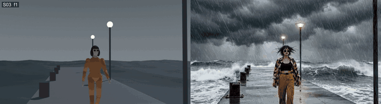
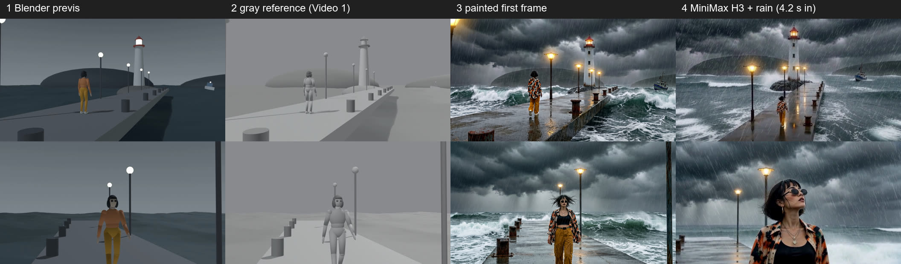
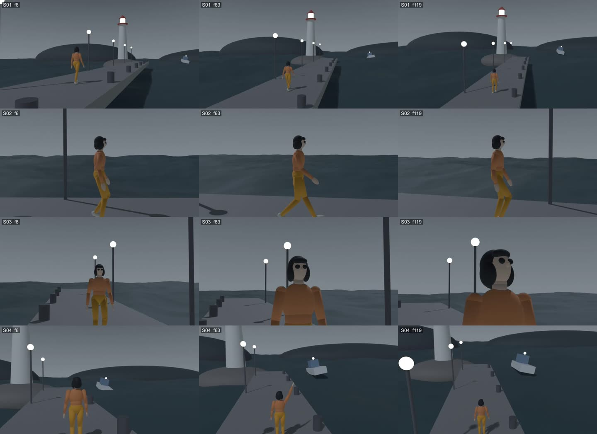
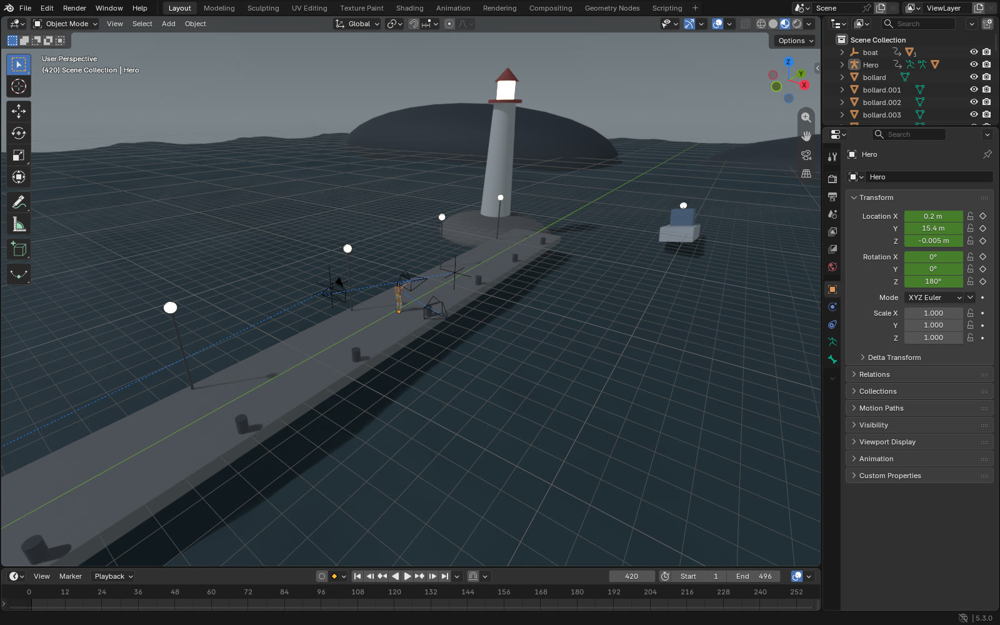
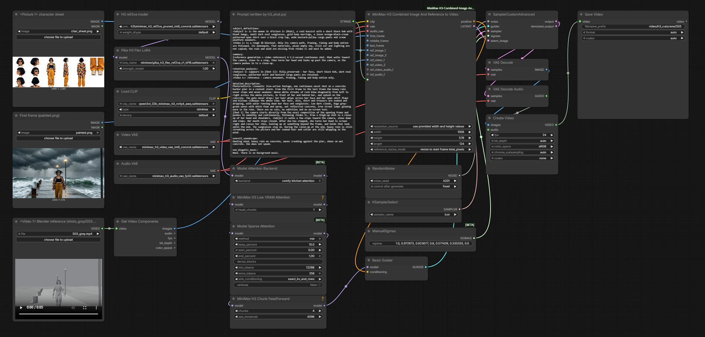
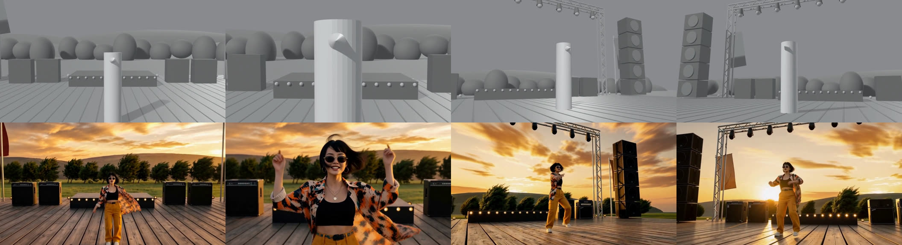
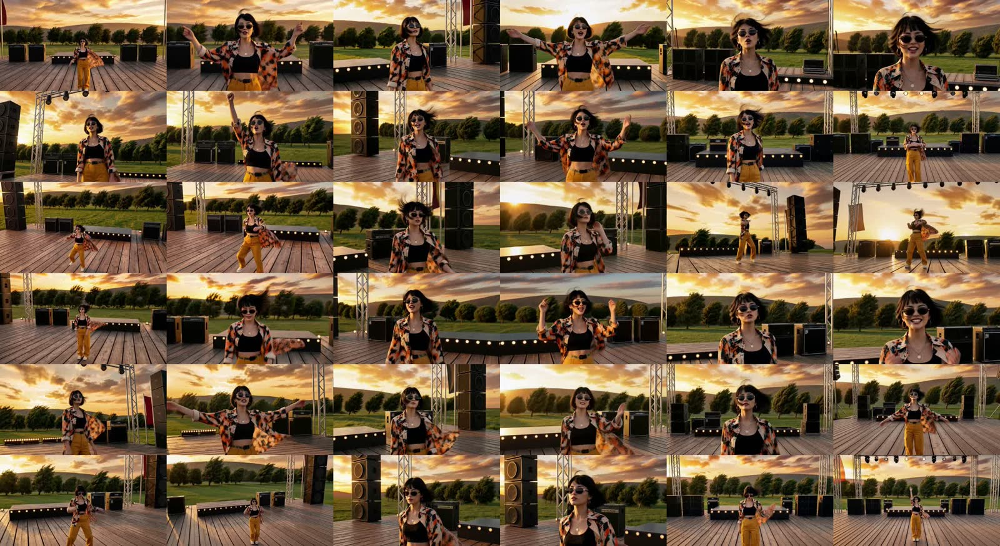

# Cutscenes: Blender previs -> MiniMax H3

[日本語](README_ja.md) | [back to H3 Chain](../README.md)

Plan a multi-shot scene in Blender (a set made of boxes, a mannequin, real camera moves), look at it, and then let
MiniMax H3 replace every shot with video that follows the Blender camera and motion. The whole scene is described in
one `cutscene.json`; you don't need to model anything. It runs on a 12 GB GPU (tested on an RTX 4070 Ti).





## Requirements

- [Blender](https://www.blender.org/) (tested with 5.3), Python 3.10+, `ffmpeg` / `ffprobe` on PATH
- ComfyUI with its own MiniMax H3 support (tested with 0.46.2)

| Custom nodes | Needed for |
|---|---|
| [MiniMax-H3-Combined-Image-And-Reference-to-Video](https://github.com/entropicnoise/MiniMax-H3-Combined-Image-And-Reference-to-Video) | A pinned first frame together with the reference image and video |
| [ComfyUI-KJNodes](https://github.com/kijai/ComfyUI-KJNodes) | MiniMax H3 Low VRAM Attention, Chunk FeedForward |

| Model folder | File |
|---|---|
| `diffusion_models/h3/` | `minimax_h3_ref2va_pruned_int8_convrot.safetensors` |
| `diffusion_models/h3/` | `minimax_h3_image_pruned_int8_convrot.safetensors` (painting the first frames) |
| `loras/minimax/` | `pika_h3_flex_ref2va_v1_bf16.safetensors` |
| `text_encoders/` | `qwen3vl_32b_minimax_h3_nvfp4_awq.safetensors` |
| `vae/` | `minimax_h3_video_vae_int8_convrot.safetensors`, `minimax_h3_audio_vae_fp32.safetensors`, `minimax_h3_image_vae_fp16.safetensors` |

The names are set in `tools/h3_base_api.json` and `tools/paint_h3image.py`; change them there if yours differ.

Environment variables: `COMFYUI_DIR` (the folder that has `custom_nodes/`), `BLENDER` (the Blender executable, if it
is not on PATH), and `COMFYUI_URL` if ComfyUI is not at `http://127.0.0.1:8188`.

```
# Windows (PowerShell)
$env:COMFYUI_DIR = "D:\ComfyUI"; $env:BLENDER = "C:\Program Files\Blender Foundation\Blender 5.3\blender.exe"
# Linux / macOS / Git Bash
export COMFYUI_DIR=/path/to/ComfyUI BLENDER=/path/to/blender
```

## Walkthrough: the Harbor example

Run from this folder. Copy `examples/Harbor` to `my_scene` first, and put your own `char_sheet.png`, `face.png` and
`fullbody.png` into `my_scene/input/` (they are not included). Change the character text in `h3.json` and the mannequin
colours in `cutscene.json` to match.

**1. Previs.** 496 frames took about 2 min 40 s.

```
python tools/render_review.py my_scene
```

This writes `cutscene.blend`, `review.mp4` (with shot names and frame numbers), `review_sheet.jpg`, and the clean
`shots/` and `shots_gray/` videos.



Open `cutscene.blend` to look around: Numpad 0 is the camera, Space plays, the timeline markers switch the cameras.
Running step 1 again rebuilds the file, so save hand edits under another name.



**2. First frames.** Repaint frame 1 of each shot with MiniMax H3 Image. H3 pins this frame.

```
mkdir -p my_scene/h3/S03
ffmpeg -i my_scene/shots/S03.mp4 -frames:v 1 my_scene/h3/S03/previs_f001.png
python tools/paint_h3image.py my_scene/h3/S03/previs_f001.png my_scene/h3/S03/painted.png "Edit <Picture 1>, a rough 3D blockout, into a photorealistic cinematic film still with exactly the same camera framing, pose, scale and layout. Replace the mannequin with the woman from <Picture 2> and <Picture 3>: (face, hair, clothes). (pose and view direction). (place and weather). Keep every object where it is and at the same size, add nothing new. No 3D render look, no text." my_scene/input/fullbody.png my_scene/input/face.png --seed 11 --mp 3
```

**3. H3.** One shot of 124 frames takes about 8 to 11 minutes. Start with the shot that has the largest face.

```
python tools/h3_shot.py my_scene S03 gray
```

`h3_shot.py` builds the prompt from `h3.json`, queues the graph and saves `h3/S03/gray/video.mp4`. The same graph is in
[`example_workflows/H3_Cutscene_Shot.json`](../example_workflows/H3_Cutscene_Shot.json) if you prefer the ComfyUI
canvas:



**4. Rain (optional).** Stronger prompts did not make H3 keep the rain, so it is drawn in Blender and blended over.

```
blender -b --factory-startup my_scene/cutscene.blend --python-exit-code 1 -P tools/rain_pass.py -- my_scene S03 --drops 20000
python tools/rain_comp.py my_scene S03 gray --strength 0.55
```

**5. Join.**

```
python tools/join.py my_scene S01=gray S02=gray S03=gray S04=gray
```

## What H3 takes from Blender

With `gray` the figure moves as stiffly as the mannequin. Choose per shot:

| Mode | Follows Blender | Free | Use for |
|---|---|---|---|
| `gray` | camera, place, body motion | - | walking, acting, planned actions |
| `position` | camera, place, facing (a pillar) | body | dance and singing |
| `camera` | camera, set | body, place | one figure where the place does not matter |
| `free` | nothing (no reference video) | all | a wild shot; the camera comes from the text |

`position` and `camera` need their reference videos first, and a `detailed_open` text in `h3.json`:

```
blender -b --factory-startup my_scene/cutscene.blend --python-exit-code 1 -P tools/ref_pass.py -- my_scene position S01 S02
python tools/h3_shot.py my_scene S01 position
```

Top: the `position` reference. Bottom: H3 dances freely in the same place with the same camera.



`"ref"` in a shot of `h3.json` (`motion`, `position`, `camera`, `free`) is used by the mode `auto`. The built-in text for
`position` and `camera` says "she / her"; set `video_role_position` / `video_role_camera` in `h3.json` for anyone else.

## Singing (lip sync)

`examples/OutdoorStage` is a whole song in 18 shots, `position` mode: `make_json.py` writes `cutscene.json` (cuts on the
bar lines), `paint_all.py` paints the first frames, `make_h3.py` writes `h3.json`. The song and the character images are
not included, and the times in the scripts belong to that song, so use it as a template.

- `song.file` in `cutscene.json` and `song.h3_audio` in `h3.json` (the song with the vocals forward; separate them with
  any stem separator). Every shot has `start` (seconds in the song) and `use` (frames kept in the film).
- Put into `input/`: `song.mp3`, `vocal_forward.wav`, `char_sheet.png`, `face.png`, and the crops `upper.png`,
  `thigh.png`, `fullbody.png`.
- `h3_shot.py` gives each shot its part of the song; `join.py` trims the shots and lays the original song underneath.



## cutscene.json

- `world`: sky colours and sun. `set`: `box`, `sphere`, `cylinder`, `cone` (`top` = top radius ratio), `ocean`, or `parts`
  for a compound object. `repeat` is `[dx, dy, dz, count]`, `keys` moves an object, `sway` rocks it, `emit` makes it glow,
  `tex` puts a crop of a photo on the front.
- `characters`: `start`, `walks` (`f`, `to`, `speed`; 1.3 m/s is a normal walk), `poses` (bone rotations in degrees at a
  frame), `groove` (sways to a beat), and the mannequin's colours. Frame numbers run over the whole film.
- Bones: `pelvis chest neck head`, and `upper_arm forearm hand thigh shin foot` with `.L` / `.R`.
- `shots`: `frames` must be 17n+5 (124 = 5.2 s). Camera keys have `t` 0..1, `pos` and `lens`; `look` is `"Hero:chest"`,
  `"Hero:head"` or position keys.

## Notes

- 12 GB: 1056x576 video with `ref_size` 704x384. A 1056x576 reference ran out of memory on some shots.
- The text decides the rest: name the action in order, the mouth state and the number of limbs. A word can become an
  object ("globe lamps" drew an Earth globe).
- Strong wind fades during a shot. Windblown first frames and a windblown character sheet help most.
- A bad shot: `--seed N --tag NAME` keeps another take in its own folder.
- Claude Code: the skill `skills/new-cutscene-movie` does all of this from a description and stops for your OK after the
  previs and after the first H3 shot.
