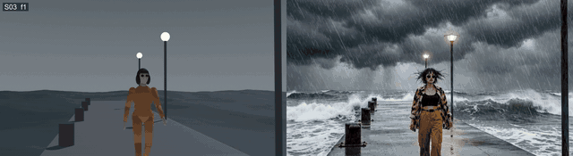
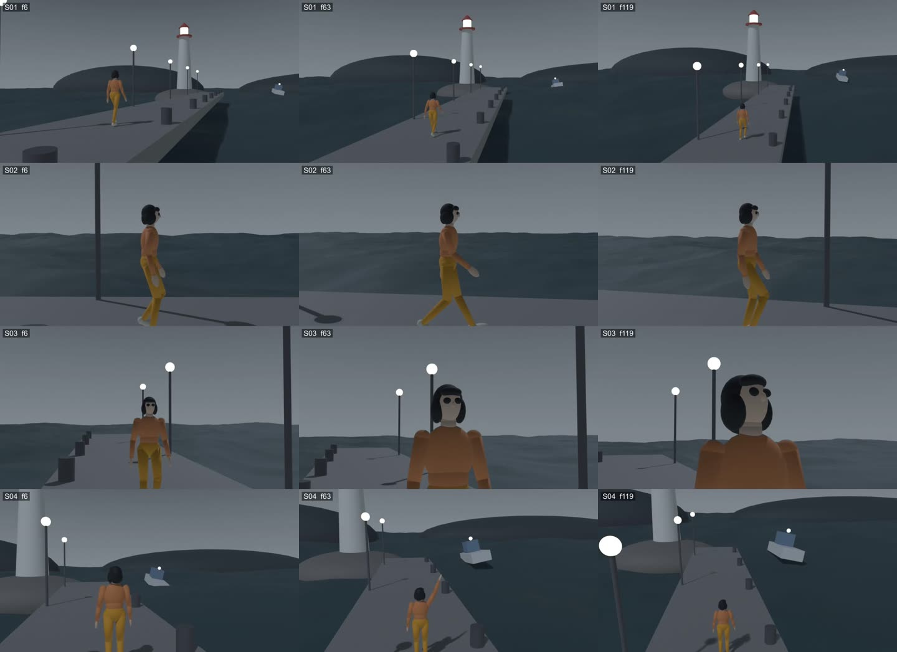
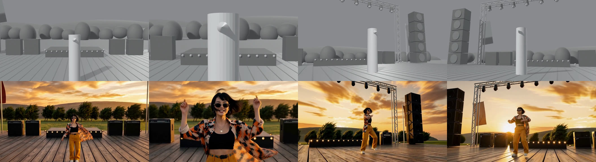
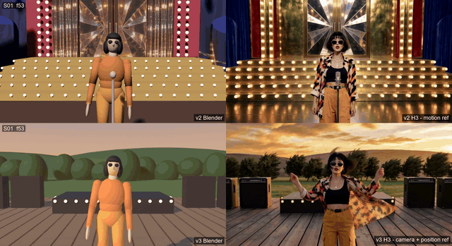
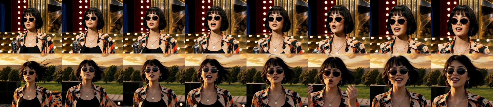
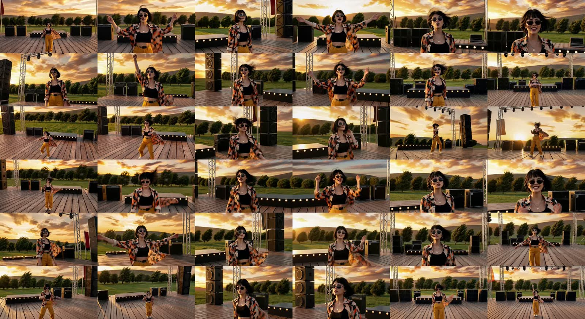

# カットシーン: Blender プリビズ → MiniMax H3

[English](README.md) | [H3 Chain に戻る](../README_ja.md)

複数カットのシーンを Blender で組み立て（箱で作ったセット、マネキン、カメラワーク）、確認してから、各ショットを MiniMax H3 の動画に置き換えます。
H3 の動画は Blender のカメラと動きに従います。シーンは 1 つの `cutscene.json` に書くだけで、モデリングは要りません。
12GB の GPU で動きます（RTX 4070 Ti で確認）。




## 必要なもの

- [Blender](https://www.blender.org/)（5.3 で確認）、Python 3.10 以上、PATH の通った `ffmpeg` / `ffprobe`
- MiniMax H3 対応の ComfyUI（0.46.2 で確認）

| カスタムノード | 用途 |
|---|---|
| [MiniMax-H3-Combined-Image-And-Reference-to-Video](https://github.com/entropicnoise/MiniMax-H3-Combined-Image-And-Reference-to-Video) | 開始フレームの固定と、参照画像・参照動画を同時に使う |
| [ComfyUI-KJNodes](https://github.com/kijai/ComfyUI-KJNodes) | MiniMax H3 Low VRAM Attention、Chunk FeedForward |

| モデルのフォルダ | ファイル |
|---|---|
| `diffusion_models/h3/` | `minimax_h3_ref2va_pruned_int8_convrot.safetensors` |
| `diffusion_models/h3/` | `minimax_h3_image_pruned_int8_convrot.safetensors`（開始フレームの描き換え） |
| `loras/minimax/` | `pika_h3_flex_ref2va_v1_bf16.safetensors` |
| `text_encoders/` | `qwen3vl_32b_minimax_h3_nvfp4_awq.safetensors` |
| `vae/` | `minimax_h3_video_vae_int8_convrot.safetensors`、`minimax_h3_audio_vae_fp32.safetensors`、`minimax_h3_image_vae_fp16.safetensors` |

ファイル名は `tools/h3_base_api.json` と `tools/paint_h3image.py` に書いてあります。違う場合はそこを直してください。

環境変数: `COMFYUI_DIR`（`custom_nodes/` のあるフォルダ）、`BLENDER`（PATH になければ Blender の実行ファイル）、
ComfyUI が `http://127.0.0.1:8188` でなければ `COMFYUI_URL`。

```
# Windows (PowerShell)
$env:COMFYUI_DIR = "D:\ComfyUI"; $env:BLENDER = "C:\Program Files\Blender Foundation\Blender 5.3\blender.exe"
# Linux / macOS / Git Bash
export COMFYUI_DIR=/path/to/ComfyUI BLENDER=/path/to/blender
```

## 手順: Harbor の例

このフォルダで実行します。先に `examples/Harbor` を `my_scene` にコピーし、`my_scene/input/` に自分の `char_sheet.png`、`face.png`、
`fullbody.png` を置きます（同梱していません）。`h3.json` のキャラクターの説明と、`cutscene.json` のマネキンの色も合わせて書き換えます。

**1. プリビズ。** 496 フレームで約 2 分 40 秒でした。

```
python tools/render_review.py my_scene
```

`cutscene.blend`、`review.mp4`（ショット名とフレーム番号入り）、`review_sheet.jpg`、文字なしの `shots/` と `shots_gray/` ができます。



`cutscene.blend` を開いて確認できます。Numpad 0 でカメラ視点、Space で再生、カットはタイムラインのマーカーで切り替わります。
手順 1 をもう一度実行すると作り直されるので、手直ししたら別名で保存してください。


**2. 開始フレーム。** 各ショットの 1 コマ目を MiniMax H3 Image で描き換えます。H3 はこのフレームから始まります。

```
mkdir -p my_scene/h3/S03
ffmpeg -i my_scene/shots/S03.mp4 -frames:v 1 my_scene/h3/S03/previs_f001.png
python tools/paint_h3image.py my_scene/h3/S03/previs_f001.png my_scene/h3/S03/painted.png "Edit <Picture 1>, a rough 3D blockout, into a photorealistic cinematic film still with exactly the same camera framing, pose, scale and layout. Replace the mannequin with the woman from <Picture 2> and <Picture 3>: (顔・髪・服). (ポーズと向き). (場所と天気). Keep every object where it is and at the same size, add nothing new. No 3D render look, no text." my_scene/input/fullbody.png my_scene/input/face.png --seed 11 --mp 3
```

**3. H3。** 124 フレームの 1 ショットで約 8〜11 分。顔が一番大きいショットから試します。

```
python tools/h3_shot.py my_scene S03 gray
```

`h3_shot.py` が `h3.json` からプロンプトを組み立てて実行し、`h3/S03/gray/video.mp4` に保存します。ComfyUI の画面で使う場合は、同じグラフが
[`example_workflows/H3_Cutscene_Shot.json`](../example_workflows/H3_Cutscene_Shot.json) にあります。


**4. 雨（任意）。** プロンプトを強めても H3 では雨が続かなかったので、Blender で描いて重ねます。

```
blender -b --factory-startup my_scene/cutscene.blend --python-exit-code 1 -P tools/rain_pass.py -- my_scene S03 --drops 20000
python tools/rain_comp.py my_scene S03 gray --strength 0.55
```

**5. つなぐ。**

```
python tools/join.py my_scene S01=gray S02=gray S03=gray S04=gray
```

## H3 が Blender から受け取るもの

`gray` では人物がマネキンと同じ硬さで動きます。ショットごとに選びます。

| モード | Blender に従う | 自由 | 向き |
|---|---|---|---|
| `gray` | カメラ、位置、体の動き | なし | 歩く、演技、決まった動作 |
| `position` | カメラ、位置、向き（柱） | 体 | ダンス、歌 |
| `camera` | カメラ、セット | 体、位置 | 位置を問わない 1 人のショット |
| `free` | なし（参照動画なし） | すべて | 自由なショット。カメラは文章で指定 |

`position` と `camera` は、先に参照動画を作り、`h3.json` に `detailed_open` を書きます。

```
blender -b --factory-startup my_scene/cutscene.blend --python-exit-code 1 -P tools/ref_pass.py -- my_scene position S01 S02
python tools/h3_shot.py my_scene S01 position
```

上が `position` の参照動画、下が H3。同じ場所・同じカメラで自由に踊ります。



`h3.json` のショットの `"ref"`（`motion`、`position`、`camera`、`free`）は、モード `auto` で使われます。`position` と `camera` の定型文は
「she / her」なので、ほかの人物では `h3.json` に `video_role_position` / `video_role_camera` を書いてください。

## 歌もの（リップシンク）

同じ曲（90 秒、18 ショット）を、同じカメラワークで 2 回作りました。セットや雰囲気も違いますが、一番の違いは H3 が Blender から受け取るものです。
どちらもボーカルを `<Audio 1>` として H3 に渡すので、口は歌に合います。



左が Blender、右が H3。上の段が動き参照版、下の段がカメラ＋位置参照版です（GIF のため音はありません）。

| | 動き参照（`gray`） | カメラ＋位置だけ参照（`position`） |
|---|---|---|
| `<Video 1>` | 灰色のマネキン | 位置と向きだけを示す柱 |
| 体 | マネキンのポーズと揺れに従う。硬い | 文章の指示で自由に踊る |
| カメラ・構図 | Blender のまま | Blender のまま |
| 口 | `<Audio 1>` に合う | `<Audio 1>` に合う |
| 振り付けを書く場所 | `cutscene.json` のポーズと `groove` | `detailed_open` にショットごとの文章 |
| 向き | 決まった振り付け、演技、立って歌う歌手 | ダンスと歌（おすすめ） |
| この作品 | 屋内の歌番組セット。18 ショット中 2 つを撮り直し | 強風の野外ステージ。18 ショット中 4 つを、風を強めるため撮り直し |

同じショット（S03）の口元を 15 フレームおきに並べたもの。上が動き参照、下がカメラ＋位置参照です。



カメラ＋位置参照版の全ショット（各 2 コマ）:



### カメラ＋位置参照版の作り方

`examples/OutdoorStage` がこの版です。`make_json.py` が `cutscene.json`（小節線でカット）、`paint_all.py` が開始フレーム、`make_h3.py` が `h3.json` を作ります。
曲とキャラクターの画像は同梱していません。時刻・風・歌の指示もその曲のものなので、ひな形として使ってください。

1. `examples/OutdoorStage` を `examples/my_song` にコピーし、`input/` に `song.mp3`、`vocal_forward.wav`（ボーカルを前に出した曲。分離ソフトで作ります）、
   `char_sheet.png`、`face.png`、切り抜きの `upper.png`、`thigh.png`、`fullbody.png` を置きます。
2. `cutscene.json`（`make_json.py` が書く）は、`song.file` が曲、各ショットの `start` が曲の秒、`use` が残すフレーム数です。カットは小節線の少し前（ここでは 0.12 秒前）に置きます。
3. `h3.json`（`make_h3.py` が書く）に `song` と、ショットごとの `"ref": "position"` と `detailed_open` を書きます。

```json
"song": {"h3_audio": "input/vocal_forward.wav",
         "text": "a section of a Japanese pop song with a female lead vocal, sung by <Subject 1>; the vocals are in front and the band is quiet behind"},
"shots": {"S05": {"ref": "position",
  "summary": "She sings and dances, seen from the right.",
  "detailed": "",
  "detailed_open": "The camera starts directly from the exact composition of the opening frame and drifts left around her, following <Video 1>. <Subject 1> sings the vocals of <Audio 1> from beginning to end: her lips, jaw and teeth move clearly on every syllable, open wide on long notes and close only at breaths. Her face stays toward the camera, and her hands and hair never cover her mouth. While singing she dances freely with her whole upper body: big arm gestures, shoulder accents, hips swaying to the beat. She has exactly two arms."}}
```

4. 実行します（例は 3 ショット分。最後は全ショットを並べます）。

```
python examples/my_song/make_json.py
python tools/render_review.py examples/my_song
python examples/my_song/paint_all.py
python examples/my_song/make_h3.py
blender -b --factory-startup examples/my_song/cutscene.blend --python-exit-code 1 -P tools/ref_pass.py -- examples/my_song position S01 S02 S03
python tools/h3_shot.py examples/my_song S03 auto
python tools/join.py examples/my_song S01=position S02=position S03=position
```

`h3_shot.py` がショットごとに曲を切り出して渡し、`join.py` が `use` の長さにそろえて元の曲を付けます。

動き参照版にする場合は、`"ref"` を書かずに文章を `detailed` に入れ、マネキンと同じ動作を書きます（「She sways gently on the spot to the beat, following <Video 1>」など）。
`video_role` には、ブロックアウトに口がないことと、顔は `<Audio 1>` に従うことを書きます。`ref_pass.py` は不要です。

### 分かったこと

- ダンスの文はショットごとに変えます。同じ文だと、同じ秒に同じポーズになります。
- 寄りのショットは肩と頭だけで踊らせ、手はあごより下に。口が見えるようにします。
- 歌のないショットには「There are no vocals: she does not sing, her lips stay closed the whole time.」。途中だけ歌うショットは秒を書きます。
- マイクで口を隠さないようにします。カメラ＋位置参照版にはマイクがありません。
- リップシンクは寄りのショットで先に試し、その後に全ショットの顔を確認します。
- 引きのショットは、開始フレームで人物が大きくなりがちです。シードを変えるか「tiny and far away, one third of the picture height」と書きます。
- 風は、文章だけではショットの途中で弱まります。風に吹かれた開始フレームとキャラシートが一番効きました。撮り直した 4 ショットは風の文を強めましたが、少ししか増えませんでした。

## cutscene.json

- `world`: 空の色と太陽。`set`: `box`、`sphere`、`cylinder`、`cone`（`top` = 上の半径の比）、`ocean`、複合物は `parts`。
  `repeat` は `[dx, dy, dz, 個数]`、`keys` で移動、`sway` で揺れ、`emit` で発光、`tex` で写真の切り抜きを正面に貼ります。
- `characters`: `start`、`walks`（`f`、`to`、`speed`。1.3 m/s が普通の歩き）、`poses`（フレームごとのボーンの角度）、`groove`（拍に合わせて揺れる）、
  マネキンの色。フレーム番号は全体の通し番号です。
- ボーン: `pelvis chest neck head`、`upper_arm forearm hand thigh shin foot` に `.L` / `.R`。
- `shots`: `frames` は 17n+5（124 = 5.2 秒）。カメラのキーは `t` 0〜1、`pos`、`lens`。`look` は `"Hero:chest"`、`"Hero:head"`、または位置のキー。

## 注意

- 12GB: 動画 1056x576、`ref_size` 704x384。参照動画も 1056x576 にすると、メモリ不足になるショットがありました。
- 残りは文章で決まります。動作の順番、口の状態、手足の数を書きます。言葉が物になることがあります（「globe lamps」で地球儀が出ました）。
- 強い風はショットの途中で弱まります。開始フレームとキャラシートを風に吹かれた絵にするのが一番効きます。
- 失敗したショットは `--seed N --tag 名前` で別のテイクとして残せます。
- Claude Code のスキル `skills/new-cutscene-movie` は、説明文からここまでを行い、プリビズ後と最初の H3 ショット後に確認のため止まります。
