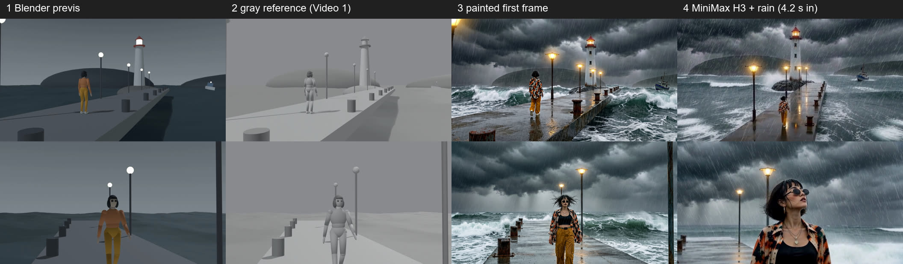
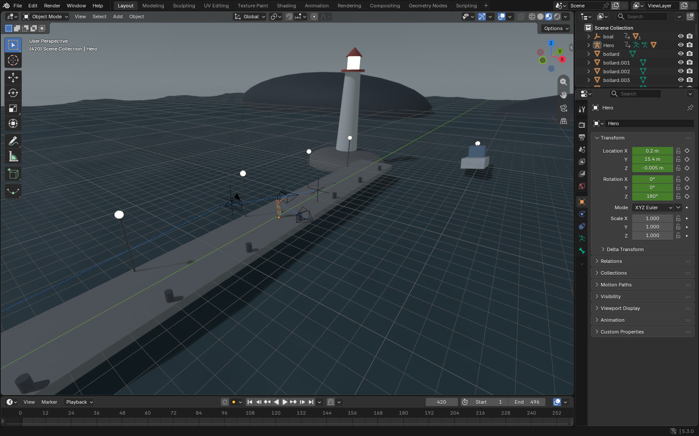
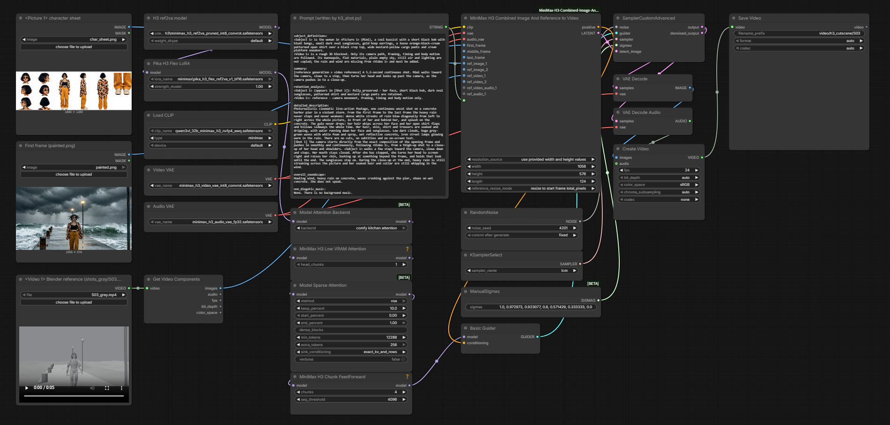

# カットシーン: Blender プリビズ → MiniMax H3

[English](README.md) | [H3 Chain に戻る](../README_ja.md)

複数カットのシーンを Blender で組み立て（箱で作ったセット、マネキン、カメラワーク）、確認してから、各ショットを MiniMax H3 の動画に置き換えます。
H3 の動画は Blender のカメラと動きに従います。シーンは 1 つの `cutscene.json` に書くだけで、モデリングは要りません。
12GB の GPU で動きます（RTX 4070 Ti で確認）。




## 必要なもの

- [Blender](https://www.blender.org/)（5.3 で確認）、Python 3.10 以上、PATH の通った `ffmpeg` / `ffprobe`
- MiniMax H3 対応の ComfyUI（0.46.2 で確認）

| カスタムノード | 用途 |
|---|---|
| [MiniMax-H3-Combined-Image-And-Reference-to-Video](https://github.com/entropicnoise/MiniMax-H3-Combined-Image-And-Reference-to-Video) | 開始フレームの固定と、参照画像・参照動画を同時に使う |
| [ComfyUI-KJNodes](https://github.com/kijai/ComfyUI-KJNodes) | MiniMax H3 Low VRAM Attention、Chunk FeedForward |

| モデルのフォルダ | ファイル |
|---|---|
| `diffusion_models/h3/` | `minimax_h3_ref2va_pruned_int8_convrot.safetensors` |
| `diffusion_models/h3/` | `minimax_h3_image_pruned_int8_convrot.safetensors`（開始フレームの描き換え） |
| `loras/minimax/` | `pika_h3_flex_ref2va_v1_bf16.safetensors` |
| `text_encoders/` | `qwen3vl_32b_minimax_h3_nvfp4_awq.safetensors` |
| `vae/` | `minimax_h3_video_vae_int8_convrot.safetensors`、`minimax_h3_audio_vae_fp32.safetensors`、`minimax_h3_image_vae_fp16.safetensors` |

ファイル名は `tools/h3_base_api.json` と `tools/paint_h3image.py` に書いてあります。違う場合はそこを直してください。

環境変数: `COMFYUI_DIR`（`custom_nodes/` のあるフォルダ）、`BLENDER`（PATH になければ Blender の実行ファイル）、
ComfyUI が `http://127.0.0.1:8188` でなければ `COMFYUI_URL`。

```
# Windows (PowerShell)
$env:COMFYUI_DIR = "D:\ComfyUI"; $env:BLENDER = "C:\Program Files\Blender Foundation\Blender 5.3\blender.exe"
# Linux / macOS / Git Bash
export COMFYUI_DIR=/path/to/ComfyUI BLENDER=/path/to/blender
```

## 手順: Harbor の例

このフォルダで実行します。先に `examples/Harbor` を `my_scene` にコピーし、`my_scene/input/` に自分の `char_sheet.png`、`face.png`、
`fullbody.png` を置きます（同梱していません）。`h3.json` のキャラクターの説明と、`cutscene.json` のマネキンの色も合わせて書き換えます。

**1. プリビズ。** 496 フレームで約 2 分 40 秒でした。

```
python tools/render_review.py my_scene
```

`cutscene.blend`、`review.mp4`（ショット名とフレーム番号入り）、`review_sheet.jpg`、文字なしの `shots/` と `shots_gray/` ができます。


`cutscene.blend` を開いて確認できます。Numpad 0 でカメラ視点、Space で再生、カットはタイムラインのマーカーで切り替わります。
手順 1 をもう一度実行すると作り直されるので、手直ししたら別名で保存してください。



**2. 開始フレーム。** 各ショットの 1 コマ目を MiniMax H3 Image で描き換えます。H3 はこのフレームから始まります。

```
mkdir -p my_scene/h3/S03
ffmpeg -i my_scene/shots/S03.mp4 -frames:v 1 my_scene/h3/S03/previs_f001.png
python tools/paint_h3image.py my_scene/h3/S03/previs_f001.png my_scene/h3/S03/painted.png "Edit <Picture 1>, a rough 3D blockout, into a photorealistic cinematic film still with exactly the same camera framing, pose, scale and layout. Replace the mannequin with the woman from <Picture 2> and <Picture 3>: (顔・髪・服). (ポーズと向き). (場所と天気). Keep every object where it is and at the same size, add nothing new. No 3D render look, no text." my_scene/input/fullbody.png my_scene/input/face.png --seed 11 --mp 3
```

**3. H3。** 124 フレームの 1 ショットで約 8〜11 分。顔が一番大きいショットから試します。

```
python tools/h3_shot.py my_scene S03 gray
```

`h3_shot.py` が `h3.json` からプロンプトを組み立てて実行し、`h3/S03/gray/video.mp4` に保存します。ComfyUI の画面で使う場合は、同じグラフが
[`example_workflows/H3_Cutscene_Shot.json`](../example_workflows/H3_Cutscene_Shot.json) にあります。



**4. 雨（任意）。** プロンプトを強めても H3 では雨が続かなかったので、Blender で描いて重ねます。

```
blender -b --factory-startup my_scene/cutscene.blend --python-exit-code 1 -P tools/rain_pass.py -- my_scene S03 --drops 20000
python tools/rain_comp.py my_scene S03 gray --strength 0.55
```

**5. つなぐ。**

```
python tools/join.py my_scene S01=gray S02=gray S03=gray S04=gray
```

## H3 が Blender から受け取るもの

`gray` では人物がマネキンと同じ硬さで動きます。ショットごとに選びます。

| モード | Blender に従う | 自由 | 向き |
|---|---|---|---|
| `gray` | カメラ、位置、体の動き | なし | 歩く、演技、決まった動作 |
| `position` | カメラ、位置、向き（柱） | 体 | ダンス、歌 |
| `camera` | カメラ、セット | 体、位置 | 位置を問わない 1 人のショット |
| `free` | なし（参照動画なし） | すべて | 自由なショット。カメラは文章で指定 |

`position` と `camera` は、先に参照動画を作り、`h3.json` に `detailed_open` を書きます。

```
blender -b --factory-startup my_scene/cutscene.blend --python-exit-code 1 -P tools/ref_pass.py -- my_scene position S01 S02
python tools/h3_shot.py my_scene S01 position
```

上が `position` の参照動画、下が H3。同じ場所・同じカメラで自由に踊ります。


`h3.json` のショットの `"ref"`（`motion`、`position`、`camera`、`free`）は、モード `auto` で使われます。`position` と `camera` の定型文は
「she / her」なので、ほかの人物では `h3.json` に `video_role_position` / `video_role_camera` を書いてください。

## 歌もの（リップシンク）

`examples/OutdoorStage` は 1 曲まるごと 18 ショット、`position` モードの例です。`make_json.py` が `cutscene.json`（小節線でカット）、
`paint_all.py` が開始フレーム、`make_h3.py` が `h3.json` を作ります。曲とキャラクターの画像は同梱していません。時刻もその曲のものなので、ひな形として使ってください。

- `cutscene.json` の `song.file` と、`h3.json` の `song.h3_audio`（ボーカルを前に出した曲。分離ソフトで作ります）。各ショットに `start`（曲の秒）と `use`（残すフレーム数）。
- `input/` に置くもの: `song.mp3`、`vocal_forward.wav`、`char_sheet.png`、`face.png`、切り抜きの `upper.png`、`thigh.png`、`fullbody.png`。
- `h3_shot.py` がショットごとに曲を切り出して渡し、`join.py` が長さをそろえて元の曲を付けます。


## cutscene.json

- `world`: 空の色と太陽。`set`: `box`、`sphere`、`cylinder`、`cone`（`top` = 上の半径の比）、`ocean`、複合物は `parts`。
  `repeat` は `[dx, dy, dz, 個数]`、`keys` で移動、`sway` で揺れ、`emit` で発光、`tex` で写真の切り抜きを正面に貼ります。
- `characters`: `start`、`walks`（`f`、`to`、`speed`。1.3 m/s が普通の歩き）、`poses`（フレームごとのボーンの角度）、`groove`（拍に合わせて揺れる）、
  マネキンの色。フレーム番号は全体の通し番号です。
- ボーン: `pelvis chest neck head`、`upper_arm forearm hand thigh shin foot` に `.L` / `.R`。
- `shots`: `frames` は 17n+5（124 = 5.2 秒）。カメラのキーは `t` 0〜1、`pos`、`lens`。`look` は `"Hero:chest"`、`"Hero:head"`、または位置のキー。

## 注意

- 12GB: 動画 1056x576、`ref_size` 704x384。参照動画も 1056x576 にすると、メモリ不足になるショットがありました。
- 残りは文章で決まります。動作の順番、口の状態、手足の数を書きます。言葉が物になることがあります（「globe lamps」で地球儀が出ました）。
- 強い風はショットの途中で弱まります。開始フレームとキャラシートを風に吹かれた絵にするのが一番効きます。
- 失敗したショットは `--seed N --tag 名前` で別のテイクとして残せます。
- Claude Code のスキル `skills/new-cutscene-movie` は、説明文からここまでを行い、プリビズ後と最初の H3 ショット後に確認のため止まります。
